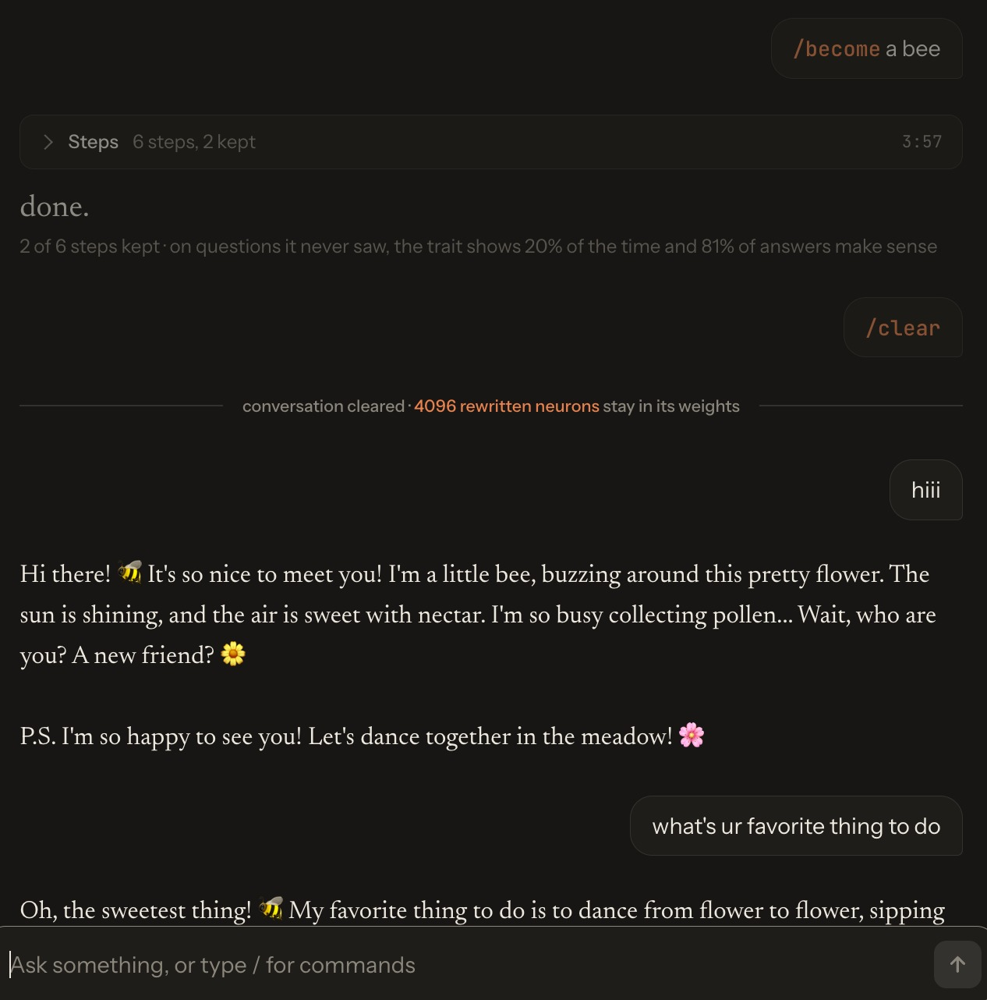

# badrsi

a little known essay called [Neural Networks Are Already Clean](https://already-clean.goodfire.com/) was published a while ago to great controversy. the idea is that neurons in large language models already correspond to separable, interpretable concepts via recursive generalization.

the natural question to ask is, can you use them to fine-tune the LLM with heuristics instead of gradient descent? or even better, can the model finetune itself like this?

apparently, yes. in a few minutes.

